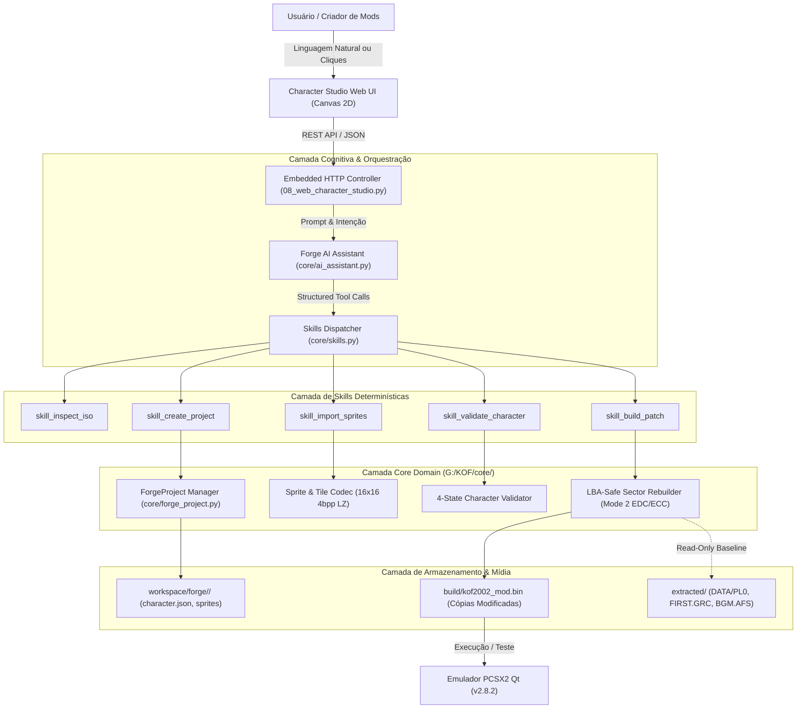
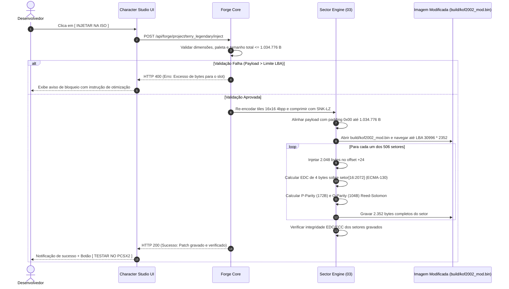

# Arquitetura do Sistema — KOF Character Forge AI
**Plataforma de Modding e Engenharia de Personagens para The King of Fighters 2002 (PS2)**  
**Serial do Jogo:** `SLES_533.81` / `SLES-53381` | **Data:** 19 de Novembro de 2026

---

## 1. Visão Geral da Arquitetura

O **KOF Character Forge AI** foi projetado sobre o princípio fundamental da **Separação Rígida entre Inteligência e Execução Binária**. O Modelo de Linguagem (LLM) atua exclusivamente como assistente cognitivo de alto nível, interpretando linguagem natural e gerando intenções estruturadas. Nenhuma saída textual de IA é executada diretamente no shell do sistema operacional ou gravada como bytes brutos no disco. Toda modificação de arquivos é mediada por **Skills Determinísticas** com validação rigorosa de tipos, dimensões, paletas e limites de memória LBA.



---

## 2. Camadas do Sistema

### 2.1. Camada de Apresentação e Estúdio Visual
- **Interface Base:** Baseada no servidor local embutido em Python (`ThreadingHTTPServer`) e Canvas 2D de alta performance.
- **Componentes de UI:**
  - **Character Select & Animation Player:** Visualização frame a frame dos 46 lutadores com interpolação de FPS, reprodução contínua e fatiamento heurístico.
  - **Character Forge Wizard (`[ + CRIAR PERSONAGEM ]`):** Fluxo guiado para criação de novos projetos via Modo B ("Usar Personagem Existente como Base", ex.: Terry Bogard $\to$ Terry Legendary).
  - **Forge AI Assistant Side Panel:** Painel lateral de conversa com histórico de ações, log de execução de ferramentas e prévia de modificações pendentes de aprovação.
  - **Palette Studio & Audio Player:** Edição de paletas de 16 cores com swatch interativo e reprodução direta de amostras ADX decodificadas para WAV PCM em memória.

### 2.2. Camada Controladora de API (REST Endpoints)
A comunicação entre o frontend no navegador e o backend ocorre através de rotas REST JSON estritas:

| Método | Endpoint | Responsabilidade |
| :--- | :--- | :--- |
| `GET` | `/api/forge/projects` | Lista todos os projetos existentes em `workspace/forge/`. |
| `POST` | `/api/forge/create` | Cria um novo projeto a partir de um slot canônico (`base_char_id`, `name`). |
| `GET` | `/api/forge/project/<name>` | Retorna os metadados do projeto (`character.json`) e árvore de arquivos. |
| `POST` | `/api/forge/project/<name>/import_sprite` | Ingestão e validação de sprite/spritesheet PNG para um frame específico. |
| `POST` | `/api/forge/project/<name>/validate` | Executa o validador completo e retorna relatório de conformidade. |
| `POST` | `/api/forge/project/<name>/inject` | Executa a montagem LBA-safe e gera a imagem mod com EDC/ECC. |
| `POST` | `/api/forge/ai/chat` | Ponto de entrada do assistente de IA com despacho de tool-calling. |

### 2.3. Camada do Agente e Tool-Calling (`core/ai_assistant.py`)
- O assistente não executa código livre. Ele avalia o prompt do usuário contra esquemas JSON padronizados de ferramentas (`tools_schema`).
- **Ciclo de Execução do Agente:**
  1. Identificação do projeto ativo e estado atual.
  2. Mapeamento da solicitação do usuário para uma ou mais skills.
  3. Validação prévia de parâmetros obrigatórios.
  4. Execução da skill determinística.
  5. Coleta do resultado estruturado e formulação de resposta explicativa em linguagem natural.

### 2.4. Camada de Domínio Core (`core/`)
- `forge_project.py`: Gerenciamento estruturado de diretórios de projetos em `workspace/forge/<project_name>/`.
- `iso_engine.py`: Encapsula a manipulação de setores do disco, validação de tamanhos e cálculo de EDC/ECC Mode 2 Form 1.
- `sprite_codec.py`: Codificação e decodificação de blocos gráficos 4bpp column-major e compressão LZ SNK.
- `palette_codec.py`: Manipulação das tabelas em `SLES_533.81` e cores RGB555 em `FIRST.GRC`.
- `audio_codec.py`: Manipulação de arquivos de som CRI ADX v4 e contêineres AFS/ACX.

---

## 3. Especificação do Formato de Personagem (`.kofchar`)

Para garantir portabilidade e isolamento, cada personagem customizado é salvo como um projeto estruturado e exportado como um arquivo ZIP contendo a extensão `.kofchar`:

```text
meu_lutador.kofchar (Arquivo ZIP)
├── character.json              # Manifesto principal do projeto
├── sprites/                    # Frames indexados 16 cores (frame_0000.png, ...)
│   ├── frame_0000.png
│   ├── frame_0001.png
│   └── offsets_map.json        # Dimensões e deslocamentos originais
├── palettes/                   # Paletas A, B, C, D
│   ├── palette_A.png
│   └── palette.json            # Cores RGB555 e RGBA
├── audio/                      # Vozes e efeitos customizados (quando suportado)
│   ├── clips/
│   └── voice_map.json
└── preview/                    # Assets para a interface
    ├── portrait.png            # Miniatura 64x64
    └── contact_sheet.png       # Folha de contato geral
```

### Estrutura do Manifesto `character.json`
```json
{
  "format_version": "1.0",
  "project_name": "Terry Legendary",
  "author": "KOF Modder",
  "base_character": {
    "char_id": 3,
    "slug": "terry",
    "canonical_name": "Terry Bogard",
    "source_bin": "/DATA/PL0/P03.BIN",
    "original_size_bytes": 1034776,
    "allocated_lba_sectors": 506,
    "lba_start": 30996,
    "palette_indices": {
      "A": 448,
      "B": 464,
      "C": 480,
      "D": 496
    }
  },
  "custom_assets": {
    "modified_frames": [0, 1, 2, 3, 4],
    "palette_modified": true,
    "voices_modified": false
  },
  "validation_status": {
    "state": "COMPATÍVEL",
    "last_checked": "2026-11-19T04:00:00Z",
    "current_payload_bytes": 1028440,
    "byte_headroom": 6336,
    "errors": [],
    "warnings": []
  }
}
```

---

## 4. Pipeline de Injeção e Recálculo EDC/ECC

O fluxo de gravação preserva a imagem original intocada e atua apenas sobre a cópia de destino:



---

## 5. Garantias de Segurança e Limites de Engenharia

1. **Garantia de Não-Regressão:** Os arquivos originais em `King of Fighters 2002, The (Europe).bin`, `.cue` e toda a árvore `extracted/` são marcados como somente leitura nos procedimentos operacionais. Nenhuma rotina abre estes caminhos com flag `'wb'` ou `'r+b'`.
2. **Prevenção de Injeção de Código Arbitrário:** O motor de IA (`ai_assistant.py`) não possui ferramentas de acesso a `subprocess.Popen` ou `os.system` com strings abertas. Cada ferramenta aceita apenas argumentos estruturados e fortemente tipados.
3. **Invariante LBA-Safe:** A capacidade de um lutador é delimitada rigidamente pelo número de setores reservados pela ISO9660 original. O slot de Terry Bogard (`P03.BIN`) possui exatamente 506 setores (1.034.776 bytes). Qualquer payload resultante superior a este número é bloqueado antes da etapa de escrita.
4. **Isolamento de Branches e Workspaces:** Projetos em desenvolvimento são mantidos em `workspace/forge/<projeto>/` e imagens geradas são depositadas em `build/`, garantindo que testes incompletos não afetem o repositório principal.
