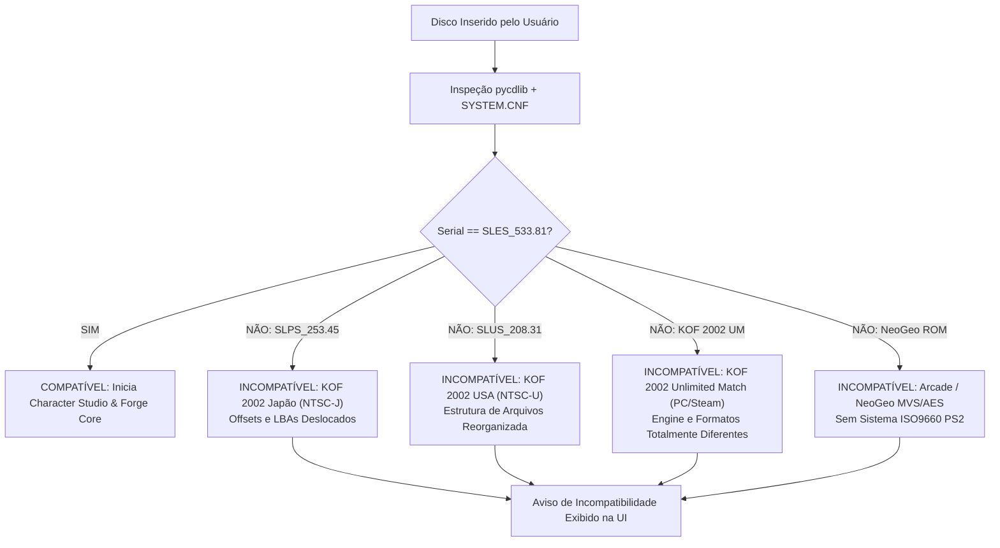

# Matriz de Compatibilidade — KOF Character Forge AI
**The King of Fighters 2002 (PlayStation 2) — Guia de Versões e Plataformas**  
**Data:** 19 de Novembro de 2026 | **Classificação:** Rigorosamente Validado

---

## 1. Alvo Homologado e Suportado Oficialmente

O pipeline do **KOF Character Forge AI** foi desenvolvido, calibrado e matematicamente verificado exclusivamente para a seguinte edição comercial:

| Propriedade | Valor de Referência Verificado |
| :--- | :--- |
| **Título do Jogo** | The King of Fighters 2002 |
| **Plataforma / Mídia** | Sony PlayStation 2 — Imagem CD-ROM Mode 2 Form 1 (`.bin` + `.cue`) |
| **Região / Território** | Europa (PAL) |
| **Serial do Executável** | `SLES_533.81` (normalizado no PCSX2 como `SLES-53381`) |
| **Boot String (`SYSTEM.CNF`)**| `BOOT2 = cdrom0:\SLES_533.81;1; VER = 1.00; VMODE = PAL` |
| **Tamanho do Executável ELF** | Exactamente `4.199.640` bytes |
| **LBA Inicial do Executável** | Setor 47 (ocupando 2.051 setores físicos) |
| **Tamanho da Imagem Bruta** | `446.463.696` bytes (189.823 setores físicos de 2.352 bytes) |
| **Offset da Tabela de Paletas**| `0x3E6960` em `SLES_533.81` (tabela de 64 entradas $\times$ 8 bytes) |
| **Contêiner de Áudio BGM/Voz** | `/ADX/BGM.AFS` (LBA 84.995, 170.283.008 bytes, 83.146 setores) |
| **Contêiner Gráfico Base** | `/DATA/BASE/FIRST.GRC` (LBA 74.747, 2.147.502 bytes, 1.049 setores) |

> [!IMPORTANT]
> **Garantia de Compatibilidade:** Todas as ferramentas determinísticas (`01` a `08`) e skills de injeção direta LBA foram calculadas com base nos offsets físicos e lógicos desta edição. O uso de qualquer outra versão causará desalinhamento de setores ou corrupção de memória.

---

## 2. Análise de Outras Versões e Regiões

### 2.1. Versão Japonesa — PlayStation 2 (NTSC-J, `SLPS-25345` / `SLPS_253.45`)
- **Status:** **INCOMPATÍVEL COM PATCH DIRETO**
- **Diferenças Críticas:**
  - **Offsets de Executável:** O executável `SLPS_253.45` possui compilação e flags de otimização de linkagem GCC MIPS distintas. A tabela de paletas dos personagens **não** se localiza no offset `0x3E6960`. Aplicar patch nesse endereço no executável japonês corrompe instruções de máquina, causando travamento imediato no boot (Kernel Trap / TLB Miss).
  - **Deslocamento de LBA:** A tabela de arquivos da imagem japonesa possui ordenação e tamanhos ligeiramente diferentes para os backgrounds (`DATA/BG`), o que desloca os LBAs de todos os 46 arquivos de lutadores (`DATA/PL0/PXX.BIN` e `DATA/PL1/PXX.BIN`).
  - **Taxa de Vídeo:** NTSC 60Hz (29.97/60 FPS, 480i) contra PAL 50Hz (576i) da versão europeia.

### 2.2. Versão Americana — PlayStation 2 (NTSC-U, `SLUS-20831` / `SLUS_208.31`)
- **Status:** **INCOMPATÍVEL COM PATCH DIRETO**
- **Diferenças Críticas:**
  - Lançada nos Estados Unidos como um pacote duplo ("The King of Fighters 2002 / 2003 Double Pack").
  - A hierarquia de pastas foi modificada pela distribuidora SNK Playmore USA para acomodar o launcher de seleção de título ou sub-árvores isoladas.
  - O manifesto de setores LBA de `SLES_533.81` é 100% incompatível com a imagem de disco americana.

### 2.3. The King of Fighters 2002 Unlimited Match (PS2 `SLPS-25916` e PC Steam / GOG)
- **Status:** **COMPLETAMENTE INCOMPATÍVEL**
- **Diferenças Críticas:**
  - O *Unlimited Match (UM)* utiliza uma engine gráfica e sonora substancialmente reconstruída:
    - Cenários em 3D poligonal renderizados em tempo real pelo GS.
    - Spritesheets e paletas empacotados em contêineres diferentes, com mais quadros de animação e balanceamento refeito.
    - Adição de novos personagens e reformulação dos slots de lutadores.
  - A versão de PC utiliza binários x86/x64 compilados para Windows com texturas DDS/PNG e arquivos de áudio OGG/WAV sem contêiner AFS/ACX do PS2.

### 2.4. ROMs de Arcade / NeoGeo MVS e NeoGeo AES (`kof2002.zip`)
- **Status:** **COMPLETAMENTE INCOMPATÍVEL**
- **Diferenças Críticas:**
  - O hardware original NeoGeo (SNK 1990-2003) utiliza barramentos de memória ROM divididos fisicamente em chips separados:
    - `C-ROMs`: Sprites em formato de pares intercalados (interleaved bitplanes de 16x16 pixels).
    - `S-ROM`: Textos e elementos fixos da tela (Fix layer 8x8).
    - `P-ROMs`: Código executável para Motorola 68000.
    - `M-ROM` / `V-ROMs`: Código Z80 e amostras de som ADPCM para Yamaha YM2610.
  - O port de PlayStation 2 unificou os gráficos de cada lutador em contêineres individuais proprietários (`PXX.BIN`), usando tiles 4bpp column-major e compressão LZ com paletas RGB555, e o áudio em CRI ADX v4.

---

## 3. Protocolo de Detecção e Proteção do Usuário

Para evitar a destruição de discos do usuário ou geração de imagens corrompidas, a camada de ingestão (`skill_inspect_iso` / `01_inspect_and_extract.py`) segue o protocolo obrigatório de segurança:

1. **Inspeção de Assinatura ISO9660:**
   - Lê o setor LBA 16 no offset `+0` (ISO pura) ou `+24` (Mode 2 Form 1).
   - Valida a presença da assinatura mágica `\x01CD001`.
2. **Leitura e Extração do `SYSTEM.CNF`:**
   - Procura o descritor de inicialização do PlayStation 2.
   - Extrai o token `BOOT2`.
3. **Validação do Serial:**
   - Se `BOOT2` contiver `SLES_533.81`, a imagem é marcada como **`COMPATÍVEL (Europe PAL)`** e o estúdio libera as ferramentas de criação.
   - Se `BOOT2` indicar qualquer outro serial (ex.: `SLPS_253.45`, `SLUS_208.31`):
     - A interface bloqueia imediatamente o botão de injeção na ISO (`[ INJETAR NA ISO ]`).
     - Um relatório explicativo é exibido detalhando que a imagem fornecida possui mapeamento de setores diferente da versão suportada.
     - É oferecida ao usuário a opção de utilizar o modo **PCSX2 Texture Replacement (Script 04)**, que substitui texturas via renderizador GS sem depender dos setores da ISO.
