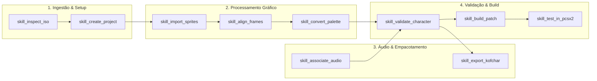

# Especificação de Skills Determinísticas — KOF Character Forge AI
**Catálogo de Habilidades e Contratos de Execução (Fase 8)**  
**Data:** 19 de Novembro de 2026 | **Versão:** 1.0.0

---

## 1. Princípios do Sistema de Skills

As **Skills Determinísticas** constituem a camada de execução segura do KOF Character Forge AI. Elas formam a única ponte autorizada entre as intenções do assistente cognitivo (LLM) ou comandos da interface e a manipulação física dos arquivos binários do jogo.

### Diretrizes Fundamentais
1. **Determinismo Absoluto:** As mesmas entradas e o mesmo estado do projeto devem sempre produzir exatamente a mesma saída de bytes.
2. **Entradas Estritamente Validadas:** Toda skill rejeita argumentos fora dos limites esperados antes de iniciar qualquer operação no disco.
3. **Idempotência e Segurança contra Falhas:** Falhas durante o processamento de uma skill nunca deixam o projeto em estado inconsistente ou corrompido.
4. **Sem Execução de Código Arbitrário:** Nenhuma skill aceita código Python, scripts bash ou comandos shell passados dinamicamente.
5. **Relatórios Estruturados:** Todas as skills retornam dicionários padronizados contendo `success: bool`, `data: dict`, `errors: list[str]` e `warnings: list[str]`.

---

## 2. Catálogo de Contratos das Skills



---

### Skill 1: `skill_inspect_iso`
- **Identificador:** `skill_inspect_iso`
- **Objetivo:** Verificar a presença, integridade física, tamanho e manifesto da imagem original de KOF 2002.
- **Pré-requisitos:** Arquivo de imagem `.bin` ou `.iso` presente no diretório raiz do projeto.
- **Parâmetros de Entrada:**
  ```json
  {
    "iso_path": "G:/KOF/King of Fighters 2002, The (Europe).bin",
    "require_manifest": true
  }
  ```
- **Ferramenta Executora:** `scripts/01_inspect_and_extract.py` via `scripts/iso_manifest.json`.
- **Validações:**
  - Existência e permissão de leitura no arquivo.
  - Verificação de setor PVD (setor 16 com assinatura `\x01CD001`).
  - Identificação de Mode 2 Form 1 (`2352` bytes/setor) ou ISO9660 padrão (`2048` bytes/setor).
- **Resultado Esperado:**
  ```json
  {
    "valid": true,
    "format": "bin2352_mode2",
    "serial": "SLES-53381",
    "executable": "SLES_533.81",
    "total_sectors": 189823,
    "manifest_file_count": 392
  }
  ```
- **Estratégia de Reversão:** Somente leitura; sem efeito colateral.

---

### Skill 2: `skill_create_project`
- **Identificador:** `skill_create_project`
- **Objetivo:** Inicializar um novo projeto de personagem isolado baseado em um lutador canônico existente (Modo B).
- **Pré-requisitos:** `extracted/` preenchido com os assets originais; nome de projeto válido e sem caracteres especiais.
- **Parâmetros de Entrada:**
  ```json
  {
    "project_name": "Terry Legendary",
    "base_char_id": 3,
    "author": "Comunidade KOF"
  }
  ```
- **Ferramenta Executora:** `core.forge_project.ForgeProject.create_project`.
- **Validações:**
  - `base_char_id` deve estar no intervalo válido de lutadores (`0x00..0x32`).
  - `workspace/forge/<slug>/` não deve existir previamente (previne sobrescrita acidental).
  - Confirmação de existência do arquivo de origem (`/DATA/PL0/P03.BIN` para Terry).
- **Resultado Esperado:**
  - Criação da pasta `workspace/forge/terry_legendary/`.
  - Geração de `character.json` com metadados do slot base (506 setores, 1.034.776 bytes).
  - Cópia do mapa de frames de referência (`offsets_map.json`).
- **Estratégia de Reversão:** Em caso de erro na inicialização, o diretório criado é completamente removido.

---

### Skill 3: `skill_import_sprites`
- **Identificador:** `skill_import_sprites`
- **Objetivo:** Ingestão de imagem PNG/JPG/WEBP externa, remoção de fundo magenta e quantização para 16 cores.
- **Pré-requisitos:** Projeto aberto; arquivo de imagem existente.
- **Parâmetros de Entrada:**
  ```json
  {
    "project_name": "Terry Legendary",
    "frame_index": 0,
    "source_image_path": "C:/Temp/terry_idle_00.png",
    "chroma_key": "#FF00FF",
    "auto_fit": true
  }
  ```
- **Ferramenta Executora:** `scripts/05_prepare_custom_frames.py`.
- **Validações:**
  - Imagem legível via Pillow.
  - Respeito aos limites máximos de tela de combate (máximo 512x512 pixels).
  - Verificação de preservação do índice 0 como transparente (`tRNS`).
- **Resultado Esperado:**
  - Gravação de `workspace/forge/<projeto>/sprites/frame_0000.png` em modo `P` (indexado 16 cores).
  - Atualização do manifesto `character.json` marcando o frame como customizado.
- **Estratégia de Reversão:** Se a quantização falhar, o frame anterior permanece inalterado.

---

### Skill 4: `skill_validate_character`
- **Identificador:** `skill_validate_character`
- **Objetivo:** Executar auditoria completa dos assets do projeto e classificar o status em 4 estados canônicos.
- **Pré-requisitos:** Projeto ativo com pelo menos um frame modificado.
- **Parâmetros de Entrada:**
  ```json
  {
    "project_name": "Terry Legendary",
    "strict_lba": true
  }
  ```
- **Ferramenta Executora:** `core.validators.validate_character`.
- **Critérios de Classificação dos 4 Estados:**
  - **`COMPATÍVEL`:** Todos os frames são PNG indexados 16 cores, índice 0 transparente, dimensões compatíveis e projeção do payload total $\le$ limite LBA do slot original (1.034.776 bytes no caso do Terry).
  - **`ATENÇÃO`:** Frames compatíveis, porém a projeção de bytes atinge mais de 95% do limite LBA ou dimensões requerem recorte suave.
  - **`INCOMPATÍVEL`:** Frame em RGBA/RGB sem paleta, cores $> 16$, índice 0 com opacidade, ou payload comprimido excede o teto de setores do slot.
  - **`NÃO VERIFICADO`:** Arquivos foram adicionados externamente mas o pipeline de validação ainda não foi executado.
- **Resultado Esperado:**
  ```json
  {
    "status": "COMPATÍVEL",
    "total_frames": 450,
    "modified_frames": 5,
    "projected_bytes": 1024512,
    "max_allowed_bytes": 1034776,
    "byte_headroom": 10264,
    "errors": [],
    "warnings": []
  }
  ```
- **Estratégia de Reversão:** Operação puramente analítica; nenhum arquivo é modificado.

---

### Skill 5: `skill_build_patch`
- **Identificador:** `skill_build_patch`
- **Objetivo:** Re-codificar os sprites modificados em blocos 4bpp LZ, gravar na imagem de disco e recalcular EDC/ECC.
- **Pré-requisitos:** `skill_validate_character` aprovado com status `COMPATÍVEL`.
- **Parâmetros de Entrada:**
  ```json
  {
    "project_name": "Terry Legendary",
    "output_image": "G:/KOF/build/kof2002_mod.bin",
    "update_palette": true
  }
  ```
- **Ferramenta Executora:** `scripts/03_build_mod_iso.py`.
- **Validações:**
  - Verificação atômica de tamanho: `payload_len <= slot_size_bytes`.
  - Recálculo de paridades ECMA-130 EDC e Reed-Solomon P/Q para cada setor de 2.352 bytes afetado.
  - Verificação bit-a-bit de integridade pós-gravação.
- **Resultado Esperado:**
  ```json
  {
    "success": true,
    "patched_file": "/DATA/PL0/P03.BIN",
    "lba_start": 30996,
    "sectors_written": 506,
    "edc_ecc_verified": true,
    "output_bin": "G:/KOF/build/kof2002_mod.bin",
    "output_cue": "G:/KOF/build/kof2002_mod.cue"
  }
  ```
- **Estratégia de Reversão:** Se ocorrer erro durante a escrita, a imagem em `build/` é restaurada da cópia de segurança intacta.

---

### Skill 6: `skill_align_frames`
- **Identificador:** `skill_align_frames`
- **Objetivo:** Ajustar ancoragem e compensação de eixos X/Y do sprite customizado para bater com o ponto de apoio (pés) do lutador original.
- **Parâmetros de Entrada:**
  ```json
  {
    "project_name": "Terry Legendary",
    "frame_index": 0,
    "anchor_point": "bottom_center"
  }
  ```
- **Ferramenta Executora:** `scripts/05_prepare_custom_frames.py` (rotina de fit bounding-box).

---

### Skill 7: `skill_convert_palette`
- **Identificador:** `skill_convert_palette`
- **Objetivo:** Extrair a paleta de 15 cores de um PNG customizado e gerar a tabela correspondente em RGB555 little-endian para injeção no sub-bloco [1] de `FIRST.GRC`.
- **Parâmetros de Entrada:**
  ```json
  {
    "project_name": "Terry Legendary",
    "palette_button": "A",
    "png_path": "workspace/forge/terry_legendary/sprites/frame_0000.png"
  }
  ```
- **Ferramenta Executora:** `core.palettes.first_grc`.

---

### Skill 8: `skill_associate_audio`
- **Identificador:** `skill_associate_audio`
- **Objetivo:** Converter e associar novos clipes de áudio (gritos, falas, golpes) para formato CRI ADX v4 e inseri-los no pacote ACX do lutador.
- **Parâmetros de Entrada:**
  ```json
  {
    "project_name": "Terry Legendary",
    "clip_index": 2,
    "source_wav": "C:/Temp/terry_burn_knuckle.wav"
  }
  ```
- **Ferramenta Executora:** `scripts/06_build_custom_voices.py`.
- **Limitações:** Requer que o pacote ACX final permaneça menor ou igual ao tamanho do arquivo no AFS (`p03.acx`: 277.548 bytes, 136 setores).

---

### Skill 9: `skill_export_kofchar`
- **Identificador:** `skill_export_kofchar`
- **Objetivo:** Empacotar todos os arquivos do projeto em um contêiner `.kofchar` (ZIP seguro) para compartilhamento.
- **Parâmetros de Entrada:**
  ```json
  {
    "project_name": "Terry Legendary",
    "destination_zip": "G:/KOF/build/terry_legendary.kofchar"
  }
  ```
- **Validações:** Prevenção de Path Traversal (rejeita links simbólicos e caminhos absolutos no arquivo ZIP).

---

### Skill 10: `skill_test_in_pcsx2`
- **Identificador:** `skill_test_in_pcsx2`
- **Objetivo:** Inicializar o emulador PCSX2 apontando para a imagem modificada em `build/kof2002_mod.bin`.
- **Parâmetros de Entrada:**
  ```json
  {
    "disc_path": "G:/KOF/build/kof2002_mod.bin",
    "fullscreen": false
  }
  ```
- **Ferramenta Executora:** `07_disc_editor.py` / `08_web_character_studio.py` (`subprocess.Popen` com caminho seguro localizado pelo registro ou diretório padrão do PCSX2).
